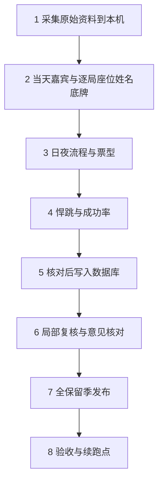

# 历史赛季数据接入全流程

更新：2026-10-28。前六步统一按[采集与对局核实](02_采集与座位姓名身份核实.md)执行，本文只保留总体顺序与后续阶段入口。已有S22 148局、S23 75局及已核实的人名、座位和照片映射直接复用；新流程处理新增资料，不重新打开既有定案，不另填任务单。



## 第1步：只采集原件到本机

固定目标赛季、官方来源、B站合集与微博发帖日期窗口。B站先取可下载的中文字幕，没有可访问中文轨才取独立音频；微博取窗口内官方账号全部可见发布、长文和配图。来源清单、原件manifest与实际进度保存在本机。

本步不做排班解析、转写、身份判断、自动入库或发布。请求失败和登录受限不能当作无数据，具体命令与完成条件见[第一步](02_采集与座位姓名身份核实.md#第一步采集原始资料)。

## 第2步：核实当天嘉宾与逐局座位、姓名、真实底牌

先识读官方照片名牌、核对当天公告与既有规范姓名，形成嘉宾名单；再结合本局白天发言图、开场点名、连续身份复盘和现有字幕/转写，分字段核实座位、姓名与物理底牌。缺文字时才转写音频，疑点按需复听或补图。

名单顺序与照片编号不是座位号；自称、解说猜测和奇幻视角标签不能代替真实底牌。保留来源、时间及既有哈希关联，未知继续未知。只生成本机核实结果，实际命令、赛季工具边界和完成条件见[第二步](02_采集与座位姓名身份核实.md#第二步核实当天嘉宾与每局座位姓名真实底牌)。

进入后续阶段前，再确认本季实际版型、技能时点、票权、计分和正式/非正式范围，完成相应注册与适配；这些规则不是第一步下载的前置条件。

## 第3步：核实白天、夜间流程与票型

复用第二步的人物身份，结合本局完整文字、程序画面和连续复盘，按实际日夜记录行动、目标/实际效果、死亡与离场、警徽及各个真实票轮。每轮保留类别、阶段、资格、候选、逐人投向/弃票与结果；首轮、PK和技能重投分别保存。

复盘时间不是动作发生时间；实际夜死与白天公布分开，资格按当时程序和当季规则核对。未知投向不当作弃票，默认弃票只按已确认票轮、已知票权集合及适用约定处理；不补造未观察到的夜晚或投票。

本步只生成本机日夜与票型核实结果、原文/画面依据和明确缺口，悍跳判定见第四步，整局胜负统计留待后续明确范围。实际命令、S21/S22/S23工具限制、减法结论及完成条件见[第三步](02_采集与座位姓名身份核实.md#第三步核实日夜流程与票型)。已有[S22票型规则](13_S22逐日投票与警下名单.md)和[S23复核](14_S23逐局推导与复核.md)保留作当季参考，不推广为新季默认规则。

## 第4步：识别悍跳与计算成功率

复用已核底牌、个人有效阵营、本人发言及日夜票型，逐个判断物理狼人是否公开自称预言家或通灵师，核清实际发生日。本人自称、引用、解说和技能获取分别理解；连续话轮未核全时保留未知，退水不删除已发生尝试。

成功沿用起跳者竞选拿徽，或首日起跳且首日最终放逐好人的口径；同人同局只计一次。成功率为成功数÷已知成功或失败的尝试数，成功未知不进分母，归属未定另列；无有效分母显示空值。具体证据、赛季限制、最少代码和停止条件见[第四步](02_采集与座位姓名身份核实.md#第四步识别悍跳与计算成功率)。本步完成本机判断和统计，不自动发布。

## 第5步：核对后写入数据库

固定本次赛季、对局及字段范围，完成相关身份、日夜、票型和悍跳核对；新适配先验证实际样板。沿用来源登记、已有正式格式、备份和事务导入，保持未知与用户确认边界。已有S22/S23成果直接复用，不为梳理流程重导整季。

S23历史快照的默认链为备份→prepare正式JSON→带幂等验证的事务导入；S22修订须指定BV，新建使用formal_entry。S21正式适配将已核身份、日夜和票型转换后导入，支持指定BV；原专项证据继续保留。原始登记与通用正式导入支持只有中文字幕的资料，无需补爬音频。

命令、原件登记、各类表、完整票型限制、悍跳随网站版本发布的顺序及停止条件，统一见[第五步](02_采集与座位姓名身份核实.md#第五步核对后写入数据库)。本步结束时记录实际回执、已知缺口和未发布状态。总体业务结构查[数据库说明](09_对局数据库与版型模板.md)，S22严格定稿规则查[正式录入](12_S22正式版型规则与录入流程.md)。

## 第6步：局部复核与意见核对

自己指定AI复核，或粘贴他人意见后逐条核对。先限定对局、字段及证据区域，对照当前值；只读足以确认来源与含义的原文/画面，有歧义才补相邻片段。已修正意见直接注明，未提到的对象不查。

每项给应修改、维持原值或资料不足及定位；仅因具体冲突或改值的实际影响检查直接依赖。用户决定采纳，已授权修正则按原范围处理；范围内问题有结论或明确缺口后收尾。两类提示词、图片/原文读法及依赖例子统一见[第六步](02_采集与座位姓名身份核实.md#第六步局部复核与意见核对)。这一步也可提前用于写库前检查。

日常局部复核直接查看目标证据。旧 `workflow --stage review` 是整季结构检查/生成，需显式 `--full-season`；入库与发布的必要版本校验继续保留，不把它们等同于整季事实重审。

## 第7步：发布所有保留季及新季照片

**要做什么**：网站publisher从磁盘正式JSON发布完整game release，再逐季同步悍跳；照片有新增时加`--photos`。新季先适配照片输入，不能调用S22/S23固定输入生成器冒充已处理新季。

```powershell
.\.venv\Scripts\python.exe scripts/workflow.py plan --season S23 --stage publish
.\.venv\Scripts\python.exe scripts/workflow.py run --season S23 --stage publish --photos
```

**产物**：`masters_web`活动release、各季悍跳、`website/api/player_photos.json`及API侧`website/assets/player-photos/`。

**验收标准**：活动版本包含新季及全部旧季，各季悍跳绑定同一game release；活动版旧季在本地缺失时停止。照片来自同季已核原图，别名有证据；无可靠照片者保留缺图原因。API代码／照片清单变更后重启API清缓存，Next构建不会刷新该缓存。底层单独`--season`／`--sample`会替换整份活动集，日常用统一入口。

计分也要核本季：现行基础分狼胜+1.5、好人胜+1、负-1，来源见[计分配置](../config/scoring_rules.user_reported.v1.json)；整季积分含决赛，冠军榜只计决赛周，跨季积分不合成冠军分。历史季差异独立适配；悍跳按同人同局去重，成功未知不进分母。

## 第8步：验收、交付并确定下次续跑点

**要做什么**：运行发布预检和通用网站验收，规则变更另跑对应语义测试；记录实际完成步骤、产物、哈希、已知／未知、导入及发布回执、旧季保留结果与下一步。

```powershell
.\.venv\Scripts\python.exe scripts/workflow.py run --season S23 --stage verify
# 只检查API时
.\.venv\Scripts\python.exe website/check_publication.py --api-only
```

**产物**：源/API/页面验收报告、必要截图、照片覆盖与缺图原因、全库及原始资料备份、真实进度和恢复点。

**验收标准**：逐季局数、座位、日夜、票轮和选票与API一致；单季／跨季统计、悍跳绑定、照片及桌面／390宽页面通过；旧季局数与内容摘要保持。记录测试覆盖边界，不将未检查特殊规则当通过，也不要求无来源的新季照片硬凑100%。下一次能按报告从未完成步骤继续，无需空白任务表。

前端改动时在`website/web`运行`npm run typecheck`和`npm run build`，再用`website/run.py --production`启动；Windows先停止占用本站standalone目录的进程。网站回退从`/api/v1/releases`取真实ID，执行`python -m website.api.publish --activate <真实ID>`并核各季悍跳；JCMS、磁盘及整库恢复另行处理。

清理先运行`python scripts/cleanup_data.py`预览引用保护和候选，再决定`--apply`。原媒体、正式档案、规则哈希、ASR分块、当前旁证和DB引用快照保留；运行环境、模型和数据库目录不删。

## 环境及资料入口

只查看现有网站时执行下列两条即可，不重跑上述接入流程：

```powershell
.\.venv\Scripts\python.exe scripts/local_postgres.py start
.\.venv\Scripts\python.exe website/run.py
```

网站<http://127.0.0.1:3000>，API文档<http://127.0.0.1:8000/docs>；复用已有服务，另开可传`--port 3001 --api-port 8001`。依赖见[requirements](../requirements/README.md)，主Python3.12和FunASR Python3.9分环境；前端在`website/web`运行`npm ci`，本机模型／CUDA见[08](08_本地资源与清理.md)。

按需查[微博分步流程](02_采集与座位姓名身份核实.md#确定当天出场嘉宾)、[脚本职责](../scripts/README.md)、[配置](../config/README.md)、[数据目录](../data/README.md)、[网站](../website/README.md)和[文档导航](README.md)。
