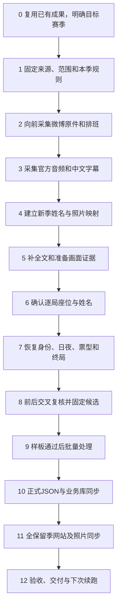

# 历史赛季数据接入全流程

更新：2026-10-27。本页用于**以后继续采集、整理和接入更早的赛季**。按顺序完成每一步，留下实际产物并达到验收标准，再进入依赖它的下一步；进度直接记在对应报告，不另填任务单。

**已有成果直接复用**：S22 148局、S23 75局，共223局，以及已核实的人名、座位、照片映射，均作为现成结果和旧季保留基线。下文的识读、推导和复核要求针对新接入赛季及新增资料，不重新打开已有定案。音频归档163／87条包含非正式媒体，不能代替正式局数。

微博已归档的发帖窗口为**2026-05-26至2026-10-20**。后续接入更早赛季时，从这个历史边界继续向前，按目标赛季实际日期采集。本轮仅整理流程及保存已有映射的一致性验收结果，没有新增日期、写业务库或重新发布。

## 执行顺序和统一命令



`workflow.py`提供`status`（读进度）、`plan`（预览命令）、`run --stage ...`（执行一个阶段，失败即停）。微博采集、名牌识读、逐局判断是独立工作，不由`workflow collect`自动完成。未适配的新季先完成注册和适配；`manual`提示不算完成。

命令均从项目根目录执行。下文S23命令展示现有可用入口；实际接入历史季时替换为**已注册且已适配的目标季**，不执行示例来重做S23。

## 第0步：复用现有成果，明确这次接哪一季

**要做什么**：核对目标赛季、官方名称及大致日期；读取已有索引和进度，区分已完成资料与目标季缺口。现有S22/S23不重新识读、推导或确认，仅保存其局数、来源摘要、照片清单和网站版本作为保留基线。

```powershell
Set-Location D:\langrensha
.\.venv\Scripts\python.exe scripts/workflow.py status --season S23
.\.venv\Scripts\python.exe scripts/workflow.py plan --season S23
```

**产物**：实际目标赛季及起止范围、已有资料位置、应继续的步骤；当前报告及旧季版本基线。

**验收标准**：明确处理的是哪一季、哪些新资料；不将已确认成果重新列为待办，不把媒体数、排班人数当成正式对局数。新季尚未注册时先做第1步，再查询状态。

## 第1步：固定官方来源、正式范围和本季规则

**要做什么**：

1. 核实B站官方账号、合集和种子BV；微博使用[京城大师赛官方账号](https://weibo.com/u/7525583841)，UID `7525583841`，保存来源原件。
2. 明确比赛日期、期次、实际局次和同媒体多局的边界，分别列出正式、表演、娱乐、加赛、决赛及未公开视频。投稿日期、节目Day和标题只作线索。
3. 在[config/seasons.json](../config/seasons.json)登记本季来源、scope、formal rules及适配；规则原图、现场个案和用户确认分开保存并记录哈希。
4. 核实本季角色配置、技能时点、淘汰边、票权、计分及决赛边界。即使版型名称相同，也先核本季差异，再决定是否复用模板。

**产物**：本季范围配置、规则文件及原图来源、版型模板、来源索引和采集计划。

**验收标准**：正式／非正式边界有来源；注册项指向真实文件，不能复制S22的排除日期／BV；没有按固定日程补造缺局。复核、导入、悍跳或照片适配缺失时先补适配，不借另一季空校验代表通过。

## 第2步：从现有历史边界向前采集微博

**要做什么**：根据目标季实际赛期，采集2026-05-26以前所需的官方帖子、完整长文、原图及排班；每个日期窗口独立保存，连续向前推进。已有窗口和已确认映射复用，跨窗口用原帖ID与图片SHA256去重。

具体登录、参数、断点续跑、原件验收和排班导出按[06 微博流程](06_微博排班采集.md)执行。微博使用自己的Cookie；采集全部可见帖，不按“排班”关键词过滤图片公告。

**产物**：`data/raw/weibo/{起日}_{止日}_京城大师赛_UID7525583841/`原件和manifest；对应`data/weibo/{起日}_{止日}/`阅读材料、排班CSV与原件验收。

**验收标准**：发帖窗口和比赛日期分开记录，作者／日期正确；扫描完成、长文完整，图片数／大小／SHA256一致，前九图之外的配图已由详情补齐。验证、登录、限流、缺游标或达到页数上限时保留进度，不算完成；先修复再继续。可见窗口扫描不等于恢复删除帖。

## 第3步：采集本季官方音频和中文字幕

**要做什么**：生成或复用本季冻结计划，续采音轨和平台字幕；已有合格原件核验后复用。

```powershell
.\.venv\Scripts\python.exe scripts/workflow.py plan --season S23 --stage collect
.\.venv\Scripts\python.exe scripts/workflow.py run --season S23 --stage collect
```

Cookie存在时默认复用，也可显式传`--auth none`或`--auth cookies`。此阶段处理B站媒体；S22历史适配中的字幕对账不直接套到新季。

**产物**：`data/indexes/{season}_采集计划.json`、`data/raw/bilibili/`音轨／字幕、采集进度与验收、中文优先队列。

**验收标准**：官方来源、BV/CID/P、哈希、时长及登记对应；每个失败条目有原因。音频归档数和正式局数分别统计。字幕缺失／疑似截短交给第5步；原媒体缺失先补采。详见[02 媒体采集](02_第一步_官方媒体采集.md)。

## 第4步：建立新季规范姓名与照片映射

**要做什么**：

1. 从微博排班原图读取名牌，按原图SHA256去重，同图的全部原帖引用保留；保存原图、名牌裁图、候选名字及识读依据。
2. 复用已核人物的规范姓名和已确认别名；新季新图仍保存自己的来源、日期和确认依据，不直接借另一季照片填充。
3. 新名字、异写和同名异人逐项核对。先按图上文字识读，必要时对照官方正文／本人介绍；不能按相貌、近似读音或正文排列顺序合并。
4. 保存直接观察、推断和用户确认的区别；已有确认不再询问，新增资料多解时再问具体问题，未知保留原因。

**产物**：新窗口／新季的照片来源索引、名牌裁图与识读记录、复核结果、逐照片映射和规范人名名单。映射至少保留赛季、姓名、照片编号、SHA256、原帖及确认依据，字段细则见[06](06_微博排班采集.md)。

**验收标准**：照片编号唯一，每条确认映射都能回原图及确认依据，所有排班配图引用有记录；明确别名与同名异人不混合。排班照片名单不是正式上场人数。当前生成器／导出器仍含S22/S23固定输入，新季先适配，不能只改路径照搬其日期和娱乐赛排除规则。

## 第5步：补齐全文并准备画面证据

**要做什么**：优先中文字幕，缺失或疑似截短时转完整音轨，覆盖赛前、局中、赛后，再登记文字；为介绍、姓名牌、投票和复盘按需截图。

```powershell
.\.venv\Scripts\python.exe scripts/workflow.py run --season S23 --stage transcribe
```

`audit_season`重建队列会清掉本地全文索引列；队列`run`复用合格分块并恢复列，最后登记文字。音频、模型配置和块哈希一致才可续跑，`raw/chunk_*.json`保留为检查点。

**产物**：中文字幕或完整ASR、原始分块与配置、阅读文本、转写登记回执、带原时点及来源哈希的原尺寸截图。

**验收标准**：全文完整度检查通过，文字时间对应原音轨；`no_short_caption_signal`不保证字词准确。数字、人名、否定及技能不清先回听，多模型一致不能代替核原音。片段时间按裁剪收据偏移映回原媒体。

片段复听示例：

```powershell
.\.venv-funasr39\Scripts\python.exe scripts/review_asr_clip.py data/raw/bilibili/BV1yt7v6QE3Q/p01/audio.m4a --start-ms 2034000 --end-ms 2060000 --out .cache/recap-review-new
```

Nano每次不超过30秒，使用独立空输出目录和不超过50个精简热词。发言截图与阅读目录也要适配本季，不能把S23已有截图进度当成新季齐备。详见[04 转写](04_第二步_单音频转写.md)、[05 复盘定位](05_复盘优先与本局信息.md)。

## 第6步：确认逐局座位，连接规范姓名与同季照片

**要做什么**：用本局姓名牌、法官点名或首局自我介绍确认座位，结合微博规范姓名与照片映射，形成“本局座位→规范姓名→同季照片”。排班只证明公告安排，实际换人、缺席和换座以现场为准。

**产物**：本季逐局座位—姓名旁证、对应原句／截图、时点和SHA，以及正式档案所用姓名。参考现有结构：S22为`data/extractions/S22/frame_seats/{BVID}.json`，S23为`data/extractions/S23/game_reviews/{BVID}/`；新季先定义并适配自己的旁证格式。

**验收标准**：座位不重复，已确定姓名可追溯到现场证据及人名映射，照片属于同季同人。跨局复用有未换人／换座依据，发生变化重新核新资料。**正文名单顺序、原帖照片序号都不能推出座位号。**照片覆盖不等于每局座位事实已核实；新增缺证据的座位明确保留未知。

## 第7步：恢复身份、日夜、票型、悍跳与终局

**要做什么**：

1. 先读连续终局复盘，建立真实底牌、逐夜行动、重要技能和胜负骨架。角色词通常修饰后面的座位，不按字幕断行配对。
2. 回局中补首次上警／警下、退水、警徽、每天每轮投票、原目标／实际效果、死亡公布、自爆、DQ和终局。
3. 查悍跳者本人完整话轮：真实狼人底牌＋公开自称预言家／通灵师，核首日、延期和后期归属；引用、假设、好人诈身份和狼混分别处理。
4. 原文、提取、推断、用户确认、未知分别保留；资料未公开继续未知，多解才提出有定位的具体问题。

**产物**：本局dossier/voting/endgame候选、逐日审计、悍跳候选及证据定位。

**验收标准**：已确定字段有原文、画面或因果唯一推导链；底牌／自称、个人胜利阵营／淘汰边、原目标／实际命中、实际死亡／公布时点、理论绑票／真实终局分开。按[16 字段证据矩阵](16_字段证据与交叉复核规范.md)逐项判断，现有赛季实例见[12 S22规则](12_S22正式版型规则与录入流程.md)、[13 投票](13_S22逐日投票与警下名单.md)、[14 S23复核](14_S23逐局推导与复核.md)。

## 第8步：前后交叉复核，固定候选版本

**要做什么**：前向重放存活、技能资格、资源、票权、投票后出局和警徽；再用后续真实发言／投票、明确放逐和终局复盘反查日次、主体及结算。修订保留旧值、新值、依据和作用域，并沿依赖重查。

```powershell
.\.venv\Scripts\python.exe scripts/workflow.py run --season S23 --stage review
```

此阶段只校验／汇总已有判断，不代替第6、7步。新季必须有真实规则和复核适配；当前S22/S23各用自身实现。

**产物**：复核页、交叉审计、反馈应用结果、固定候选snapshot及源／规则哈希。

**验收标准**：没有未解释的存活、票权、日序或结算冲突；反馈与固定候选对应，未知有原因。`--require-complete`表示材料齐备，不表示每字段人工确认。失败时回具体来源或规则，不能靠补造票轮消除报错。

## 第9步：先通过样板，再扩展到整季

**要做什么**：选一局字幕清楚的普通局和一局缺字幕／特殊结算局，各自跑通采集、姓名照片、座位、推导、复核、正式入库和网站。样板的导入／发布按第10—12步执行，通过后再扩展新季批量。

**产物**：两类样板的完整证据、正式记录、入库／发布回执、网站验收，以及适配缺口的实际修复。

**验收标准**：新季适配真实处理规则、字幕缺口、姓名照片和特殊结算；重复导入稳定，旧季内容保持。样板未通过先修对应步骤，不扩大整季批量写库。

## 第10步：生成正式JSON并同步业务库

**要做什么**：固定已接受候选，先备份全库和所有保留季基线，再做来源关联、预检及事务导入。注册新季不会自动产生正式导入器。

```powershell
.\.venv\Scripts\python.exe scripts/workflow.py plan --season S23 --stage import
.\.venv\Scripts\python.exe scripts/workflow.py run --season S23 --stage import
```

现有S23适配含备份、prepare/check/check-db及重复导入验证。S22修订指定`--bvid`，新建一局用[formal_entry的init/check/import](12_S22正式版型规则与录入流程.md)，两种入口不混用。

**产物**：`data/games/{season}`正式dossier/voting/endgame、JCMS记录、来源关联、入库回执和全库备份。

**验收标准**：磁盘正式JSON、预检及事务回执一致；重复导入内容稳定；所有旧季局数及内容摘要保持。只改JCMS不等于磁盘或网站已同步。S22批处理通常写`database_receipt.json`，单局formal_entry由命令返回回执；S23有磁盘及数据库正式回执。

`backup_database.py`记录全部保留季源摘要、局数和网站指纹。`restore_verified:false`表示未做整库实际恢复；`python -m website.backup --verify-restore`只验证网站schema，不替代JCMS及媒体备份。

## 第11步：发布所有保留季及新季照片

**要做什么**：网站publisher从磁盘正式JSON发布完整game release，再逐季同步悍跳；照片有新增时加`--photos`。新季先适配照片输入，不能调用S22/S23固定输入生成器冒充已处理新季。

```powershell
.\.venv\Scripts\python.exe scripts/workflow.py plan --season S23 --stage publish
.\.venv\Scripts\python.exe scripts/workflow.py run --season S23 --stage publish --photos
```

**产物**：`masters_web`活动release、各季悍跳、`website/api/player_photos.json`及API侧`website/assets/player-photos/`。

**验收标准**：活动版本包含新季及全部旧季，各季悍跳绑定同一game release；活动版旧季在本地缺失时停止。照片来自同季已核原图，别名有证据；无可靠照片者保留缺图原因。API代码／照片清单变更后重启API清缓存，Next构建不会刷新该缓存。底层单独`--season`／`--sample`会替换整份活动集，日常用统一入口。

计分也要核本季：现行基础分狼胜+1.5、好人胜+1、负-1，来源见[计分配置](../config/scoring_rules.user_reported.v1.json)；整季积分含决赛，冠军榜只计决赛周，跨季积分不合成冠军分。历史季差异独立适配；悍跳按同人同局去重，成功未知不进分母。

## 第12步：验收、交付并确定下次续跑点

**要做什么**：运行发布预检和通用网站验收，规则变更另跑对应语义测试；记录实际完成步骤、产物、哈希、已知／未知、导入及发布回执、旧季保留结果与下一步。

```powershell
.\.venv\Scripts\python.exe scripts/workflow.py run --season S23 --stage verify
# 只检查API时
.\.venv\Scripts\python.exe website/check_publication.py --api-only
```

**产物**：源/API/页面验收报告、必要截图、照片覆盖与缺图原因、全库及原始资料备份、真实进度和恢复点。

**验收标准**：逐季局数、座位、日夜、票轮和选票与API一致；单季／跨季统计、悍跳绑定、照片及桌面／390宽页面通过；旧季局数与内容摘要保持。记录测试覆盖边界，不将未检查特殊规则当通过，也不要求无来源的新季照片硬凑100%。下一次能按报告从未完成步骤继续，无需空白任务表。

前端改动时在`website/web`运行`npm run typecheck`和`npm run build`，再用`website/run.py --production`启动；Windows先停止占用本站standalone目录的进程。网站回退从`/api/v1/releases`取真实ID，执行`python -m website.api.publish --activate <真实ID>`并核各季悍跳；JCMS、磁盘及整库恢复另行处理。

清理先运行`python scripts/cleanup_data.py`预览引用保护和候选，再决定`--apply`。原媒体、正式档案、规则哈希、ASR分块、当前旁证和DB引用快照保留；运行环境、模型和数据库目录不删。

## 环境及资料入口

只查看现有网站时执行下列两条即可，不重跑上述接入流程：

```powershell
.\.venv\Scripts\python.exe scripts/local_postgres.py start
.\.venv\Scripts\python.exe website/run.py
```

网站<http://127.0.0.1:3000>，API文档<http://127.0.0.1:8000/docs>；复用已有服务，另开可传`--port 3001 --api-port 8001`。依赖见[requirements](../requirements/README.md)，主Python3.12和FunASR Python3.9分环境；前端在`website/web`运行`npm ci`，本机模型／CUDA见[08](08_本地资源与清理.md)。

按需查[微博分步流程](06_微博排班采集.md)、[脚本职责](../scripts/README.md)、[配置](../config/README.md)、[数据目录](../data/README.md)、[网站](../website/README.md)和[文档导航](README.md)。
