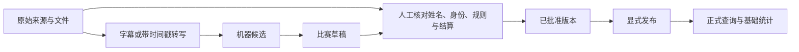

# 数据库与单视频完整流程

> 历史参考：本文件保留此前方案与试验过程。当前执行范围以 [项目入口](../../../README.md) 和 [三步路线](../../01_项目路线.md) 为准；当前只推进第一步原始媒体采集。旧文中的“下一步”不作为当前任务。

更新：2026-10-20。所有 PowerShell 命令从 `D:\langrensha` 执行。

当前决定：先用 PostgreSQL 建立数据底座，跑通一条视频的来源、音频、转写和候选入库；继续使用现有 Whisper base，先由你复核，必要时再比较其他模型。

## 1. 现在实际完成到哪里

样板是 [BV1tj8p6REqy](https://www.bilibili.com/video/BV1tj8p6REqy/)，标题为 S22 2026-08-19 决赛 Day-2 第一局「预女猎白混」。赛季、比赛日期和阶段目前来自标题，仍是待核验信息。

| 项目 | 已有结果 |
| --- | --- |
| 数据库 | PostgreSQL 18.6，已启动在 `127.0.0.1:55432`，库名及 schema 均为 `jcms` |
| 原始媒体 | 独立 AAC 音轨，52,034,797 字节，约 49.6 MiB；没有下载整段视频 |
| 全文转写 | 完整解码时长约 65 分 35.53 秒，2,107 个机器转写片段，JSON 与 SRT 均已生成 |
| 数据库转写 | 片段试验与全文两次运行，共 2,276 段；保留各自模型、参数和原音频哈希 |
| 结构化候选 | 一局、12 个座位，来自前次片段转写的整理；全文转写作为补充来源，没有冒充重新抽取过全部事实 |
| 规则 | 用户口述计分规则、样板板子候选各一份，均未核验，均未自动应用 |
| 人工复核 | 已导出 `data/reviews/pilot.review.json`，未代替你确认 |
| 正式发布 | 0 局；真实选手身份与积分尚未确认，正式统计为空 |
| 微博 | 已有帖子/有限作者分页采集入口与数据库导入入口；本环境匿名探测受登录/访问限制，没有成功取得真实微博帖子 |

这次完成的是“来源 → 音频 → 全文转写 → 候选入库 → 可人工复核”的实际链路。复核、发布、更正、撤回命令已经实现，并用隔离的合成数据验证；真实样板仍等待事实核对。不能把它写成“已有一局正式统计”。

## 2. 为什么用 PostgreSQL

比赛、赛季、选手、座位、角色、规则、证据和发布版本之间有明确关系。选错关系会直接造成重复比赛、错认选手或错误胜率，因此使用关系型数据库。

选择 **PostgreSQL**，具体设计是：

- 比赛、选手、座位和版本使用结构化表、外键、唯一约束与事务。
- 未整理的来源信息和机器候选使用 JSONB；它支持 JSON 查询与索引，适合保留可变候选结构。[PostgreSQL JSON 文档](https://www.postgresql.org/docs/current/datatype-json.html)
- 音频、图片和原始 JSON 留在 `data/`，数据库只保存文件路径、大小和 SHA-256，避免把大文件塞进业务表。
- 正式统计只查询当前发布版本。修改草稿不改变已发布结果，撤回会使该局离开正式统计。

SQLite 适合单文件小工具，但本项目后面需要后台、多人维护和发布事务，直接使用 PostgreSQL 可减少迁移工作。当前不需要额外引入 MongoDB、向量数据库或 Redis。

使用 PostgreSQL 官方 Windows 下载页指向的 EDB 二进制 ZIP；便携安装只放进本项目，不注册系统服务，不改系统 PATH。[官方下载说明](https://www.postgresql.org/download/windows/)

当前连接账号用于本机开发，具有建库及迁移权限。上线前另建权限受限的应用账号，并完成备份恢复和访问控制；当前配置不能直接当作生产部署。

## 3. 数据在库里如何组织

| 部分 | 主要对象 | 保存内容 |
| --- | --- | --- |
| 赛事身份 | `seasons`、`games` | 稳定赛季及比赛 ID、主来源、当前发布指针 |
| 来源档案 | `sources`、`artifacts` | BV/CID 或微博帖子 ID、作者、原文链接、文件哈希 |
| 转写及抽取 | `transcription_runs`、`transcript_segments`、`extraction_runs` | 模型版本、分段时间、原文、机器候选 |
| 比赛事实 | `game_revisions`、`game_participants` | 日期、阶段、配置、座位、选手、角色、阵营、个人结果和分数 |
| 选手身份 | `players`、`player_aliases` | 稳定 UUID、展示昵称、别名；不会因为同名自动合并 |
| 规则及积分段 | `rule_versions`、`scoring_periods` | 逐季规则；正赛和决赛周独立，规则更正保留旧版本 |
| 复核及操作记录 | `evidence_links`、`reviews`、`publication_events`、`audit_events` | 字段证据、人工审核、发布、撤回、更正记录 |



数据库会阻止重复座位、同局重复选手、未复核版本发布、错误来源关联，以及已提交事实原地修改。普通按阵营结算的板子还检查角色配额和个人胜负的一致性。特殊角色和特殊胜利条件必须使用对应已核验规则，不能凭常见规则推断。

分数保存为 `base_points`（基础分）、`adjustments`（奖惩）、`official_points`（官方公布分）。这三个字段允许未知，不把计算值当作官方分数。现阶段只实现发布后的出场、胜负和胜率基础视图；赛季积分榜、冠军计算、投票和夜间事件仍需后续实现。

## 4. 环境、数据库启动及日常命令

当时曾建立两个环境：`.venv` 用于采集和数据库，`.venv-asr` 用于 Whisper 转写；后者已于 2026-10-22 删除。本文件中的 Whisper 命令不适用于当前环境。以下命令不用激活环境，也不用修改 PowerShell 执行策略。

```powershell
Set-Location D:\langrensha

# 查看数据库进程及业务数据
python scripts/local_postgres.py status
.\.venv\Scripts\python.exe scripts/database.py status

# 电脑重启后，手动启动
python scripts/local_postgres.py start

# 执行新增迁移；已经执行的迁移不会重复创建表
.\.venv\Scripts\python.exe scripts/database.py migrate

# 不用时正常停止；会保留数据
python scripts/local_postgres.py stop
```

只在首次重建机器环境时执行：

```powershell
python -m venv .venv
.\.venv\Scripts\python.exe -m pip install -r requirements/collection.txt
python scripts/local_postgres.py setup
.\.venv\Scripts\python.exe scripts/database.py migrate

# 历史 Whisper 安装命令不适用：.venv-asr 和 requirements-asr.txt 已于 2026-10-22 删除。当前 ASR 使用 .venv-funasr39 + requirements/funasr.txt。
```

`.tools/postgresql/` 是程序，`.local/postgresql/` 是数据库数据，`.secrets/database.json` 是本机连接配置。它们已被 Git 忽略。保留 `.local` 才能保留数据库；不要在数据库运行时直接复制该目录作为可靠备份。当前机器已有 `.models/base-local`，离线转写可以直接复用；重建 ASR 环境不会自动恢复模型权重。

## 5. 第一步：B 站元数据和字幕

默认不登录，只获取元数据及当前可访问字幕，不下载音视频：

```powershell
.\.venv\Scripts\python.exe scripts/collect_bilibili_audio.py BV1tj8p6REqy --auth none
```

这条样本的匿名字幕接口返回 `need_login_subtitle=true`，状态是 `login_required`。它说明当前请求需要登录才能继续检查，不能据此断言“视频没有字幕”。登录后也可能没有轨道，或当前接口不暴露播放器中的某种字幕；需按返回状态判断。

脚本遇到可见字幕会保存原始 JSON 和轨道元信息，包括平台返回的人工/AI 标记。平台 AI 字幕同样需要核对。当前没有接入播放器所有潜在字幕渠道，也没有实现 WBI 字幕接口适配。

可选登录步骤由你在本机执行：

```powershell
# 打开独立 Edge 浏览器配置，按页面提示正常登录，回终端按 Enter
.\.venv\Scripts\python.exe scripts/login_session.py bilibili

# 明确使用刚导出的 Cookie，再检查字幕
.\.venv\Scripts\python.exe scripts/collect_bilibili_audio.py BV1tj8p6REqy --auth cookies --cookies-file .secrets/bilibili.cookies.txt
```

没有 Edge 时，可给登录助手加 `--channel chrome`。登录助手只导出平台域内 Cookie，不接管已有浏览器配置。导出成功不保证会话有效；本次尚未运行真实账号登录路径。Cookie 不需要贴到聊天里。

`--auth none` 与 `--auth cookies` 是可选分支；未明确选择后者时不读取 Cookie。采集器不会自行登录或处理验证页面。

## 6. 第二步：需要时只下载音频

字幕不足或要保留原始复核依据时，下载独立音轨：

```powershell
.\.venv\Scripts\python.exe scripts/collect_bilibili_audio.py BV1tj8p6REqy --audio --auth none

# 只有确实需要登录态时才用这一条
.\.venv\Scripts\python.exe scripts/collect_bilibili_audio.py BV1tj8p6REqy --audio --auth cookies --cookies-file .secrets/bilibili.cookies.txt
```

样板音频已下载，不需要再下载一次。脚本只选择独立 `audio/mp4` 音轨，有码率和文件大小上限；没有独立音轨就停止，不回退下载整段视频。普通公开视频不一定需要登录，这条样板已匿名成功；其他视频以接口实际权限为准。

输出位置：

```text
data/raw/bilibili/BV1tj8p6REqy/p01/
  metadata.raw.json
  manifest.json
  audio.m4a
```

重新采集可能更新该目录的清单。入库时会把原始 JSON、字幕、ASR 和候选复制到 `data/archive/` 的内容哈希快照，保留不同版本；音频继续使用原位置，不额外复制一份媒体。数据库和 `data/` 需要共同备份，不能只保留业务表。

关键画面仍有价值：当晚阵容、座次、板子配置、终局身份和积分图。当前尚未实现远程定点抽帧和 OCR；本轮不为了这些画面默认下载完整视频。可以先在播放器相应时间人工核对，后续补有流量和缓存上限的抽帧入口。

## 7. 第三步：现有模型转写

当前组合为 **faster-whisper 1.2.1 + 多语言 Whisper base + CPU INT8**。faster-whisper 是推理引擎，base 是模型权重。

先用现有模型是合适的，但目前只能确认它能完成转写，不能确认准确率已经足够。普通发言可帮助理解经过；选手姓名、座位号、票数、身份和特殊结算必须回听或看图。

完整转写命令：

```powershell
.\.venv-asr\Scripts\python.exe scripts/transcribe_audio.py data/raw/bilibili/BV1tj8p6REqy/p01/audio.m4a --model .models/base-local --offline --clips full --out data/transcripts/BV1tj8p6REqy.full.asr.json
```

这次已执行完成，现成文件可直接查看：

- `data/transcripts/BV1tj8p6REqy.full.asr.json`：全文、秒数及运行信息。
- `data/transcripts/BV1tj8p6REqy.full.asr.srt`：带时间戳的易读字幕。
- `data/transcripts/BV1tj8p6REqy.sample.v2.asr.json`：前次开头与结尾的片段试验，候选证据索引仍指向它。

不必为了了解一局就逐字修完全文。先核对：开头自我介绍是否覆盖当天嘉宾；本局实际座次是否有调整；终局复盘能否确认每座身份、混血选择及最终胜负。自我介绍不必然包含整套实际座次，嘉宾名单也不等于每局上场名单。

本轮不下载、安装或运行新的大模型。人工复核时记录“关键事实需改几处、哪些要回听、每局耗时”。如果你能轻松补齐 L1，继续用 base；如果关键数字经常错、专名难以恢复或逐局复核太慢，再用同一批人工真值片段比较 large-v3、Qwen3-ASR 等。没有人工真值前不报项目准确率，也不按模型榜单直接换模型。候选研究见[中文转写模型选型核验](中文转写模型选型核验.md)。

## 8. 第四步：结构化候选及入库

样板候选保存在 `data/candidates/BV1tj8p6REqy.game.candidate.json`。目前它是助手依据片段 ASR 整理的显式候选，**没有通用的任意视频自动抽取脚本**；全文转写完成也不会自动把所有发言转换成事件。

```powershell
# 一条样板的来源、文件、两次转写及候选关联入库；可重复执行
.\.venv\Scripts\python.exe scripts/database.py import-pilot --transcript data/transcripts/BV1tj8p6REqy.full.asr.json

# 记录用户口述规则，保持未核验且不绑定任何赛季积分段
.\.venv\Scripts\python.exe scripts/database.py seed-reported-rules

# 记录这个板子的候选，不据此批准比赛
.\.venv\Scripts\python.exe scripts/database.py import-rule config/S22-pilot-board.candidate.json

.\.venv\Scripts\python.exe scripts/database.py status
```

`import-pilot` 是本轮样板入口，不能声称它已经支持所有视频、整季批量入库或赛季目录管理。`collect_bilibili_audio.py` 可以采集其他 BV，但其他视频的候选形成及通用导入仍需下一步扩展。

## 9. 微博：历史阵容能否找到，是否需要登录

能找到部分历史资料。例如已核对的[官方 S19 阵容公告](https://www.weibo.com/7525583841/Q6cG6kgmH)发表于 2025-09-25，说明旧日期阵容资料确实存在。这个历史样例不能代替 S22 样板当日资料。

历史采集采用两种入口：

1. 已知帖子链接/ID：优先精确取回，避免从最新动态一直翻页。
2. 已知作者：从当前时间线有限分页，再按发布日期和关键词过滤；**日期参数不是历史搜索接口，不会直接跳到起始日期**。

日期很早时，5 页可能根本到不了目标月份。应先用官方主页、公开搜索结果或已知资料找到具体帖子，再按 ID 采集。删除、不可见、索引缺失和接口限制都可能使旧帖子无法取回；不能承诺找齐所有赛季。

匿名命令：

```powershell
# 历史帖子读取试验；该帖子是 S19 示例
.\.venv\Scripts\python.exe scripts/collect_weibo.py --post https://www.weibo.com/7525583841/Q6cG6kgmH --auth none --download-images

# 样板日期附近的有限作者分页；没有结果不代表没有发帖
.\.venv\Scripts\python.exe scripts/collect_weibo.py --uid 7525583841 --since 2026-08-18 --until 2026-08-21 --keyword "阵容,配置,板子,积分,规则,决赛" --max-pages 5 --auth none --download-images
```

**微博登录在命令上是可选的，但本环境匿名探测遇到跳转、登录/验证提示和 HTTP 432，所以实际采集很可能需要你正常登录后的 Cookie。** 登录也不保证历史完整或接口一定可用。访问限制会停止本次采集并保存原因。

```powershell
# 在独立浏览器内正常登录移动端微博，然后回终端按 Enter
.\.venv\Scripts\python.exe scripts/login_session.py weibo

# 使用你显式导出的会话；其余参数完全相同
.\.venv\Scripts\python.exe scripts/collect_weibo.py --post Q6cG6kgmH --auth cookies --cookies-file .secrets/weibo.cookies.txt --download-images

.\.venv\Scripts\python.exe scripts/collect_weibo.py --uid 7525583841 --since 2026-08-18 --until 2026-08-21 --keyword "阵容,配置,板子,积分,规则,决赛" --max-pages 5 --auth cookies --cookies-file .secrets/weibo.cookies.txt --download-images
```

作者分页始终标记 `partial`，不会宣布历史已全部取完。`--download-images` 只取图片，不取视频和评论；积分、阵容和规则常在图片里，建议对命中的少量官方帖子开启。

采集结束后打印清单路径。把那个实际路径传给数据库：

```powershell
# 将下面路径替换为采集终端实际输出的 manifest.json
.\.venv\Scripts\python.exe scripts/database.py import-weibo "data/raw/weibo/实际运行目录/manifest.json"
.\.venv\Scripts\python.exe scripts/database.py catalog sources
```

导入只登记实际取得的帖子与图片，不把正文自动变成比赛事实；空的受限清单导入 0 条。微博发帖日也不等于比赛日，阵容预告也不证明每局实际座次。规则/积分更正、当季规则图、当日阵容与配置图最值得采集；广告、其他赛事、评论和生活动态优先级低。

接口来源、已测访问边界见[微博历史采集说明](微博历史采集说明.md)。

## 10. 第五步：人工核对规则和比赛

先看[样板视频人工复核清单](样板视频人工复核清单.md)，再编辑 `data/reviews/pilot.review.json`。文件已经生成，重新导出不会覆盖它：

```powershell
# 只在需要另存一份最新草稿时执行
.\.venv\Scripts\python.exe scripts/database.py export-review --out data/reviews/pilot.review.next.json

# 查询复核时需要填写的稳定 ID
.\.venv\Scripts\python.exe scripts/database.py catalog sources
.\.venv\Scripts\python.exe scripts/database.py catalog players
.\.venv\Scripts\python.exe scripts/database.py catalog rules
.\.venv\Scripts\python.exe scripts/database.py catalog periods
```

每座填写实际昵称、选手 ID、角色、开局阵营、结算阵营和个人结果。新选手 ID 可明确填 `new:核实后的昵称`，已有选手则使用其 UUID；同名时必须先确认身份。角色代码与板子规则中的键一致；`good`、`werewolf`、`hybrid` 等阵营不能混同“角色名称”。

`facts` 中确认比赛日期、阶段、局序、是否加赛、是否计分、比赛状态、胜方、人数、板子规则 ID 和积分段 ID。完成比赛状态使用 `completed`，个人结果使用 `win`/`loss`/`draw`/`no_result`；未核对不要填写肯定值。`proposed` 仅供参考。

六类证据 `scope`、`roster`、`roles`、`results`、`rules`、`scoring` 均需填写来源 ID 与明确定位，例如媒体秒数、微博图片名和相应条款。原局复盘能证明身份，不一定足以证明这个赛季的计分规则。

### 10.1 把已核实规则另存新版本

现有板子文件是候选。核实后复制另存为 `data/reviews/S22-board.reviewed.json`，改为一个新的 `code`，填写真实 `reviewer`、`evidence_locator`，确认适用赛季、角色配额、结算方式，再显式设置 `verified=true` 和 `review_complete=true`：

```powershell
.\.venv\Scripts\python.exe scripts/database.py import-rule data/reviews/S22-board.reviewed.json
```

计分规则使用相同顶层格式，`kind` 为 `scoring`，`season_code` 指定赛季，`source_id` 引用实际取得并核对的规则来源，`definition` 保存核实后的完整规则。例子的空字段不能直接导入成已核验规则：

```json
{
  "code": "S22-scoring-reviewed-v1",
  "kind": "scoring",
  "season_code": "S22",
  "source_id": "填写已入库证据来源的 UUID",
  "verified": false,
  "review_complete": false,
  "reviewer": "",
  "evidence_locator": "",
  "definition": {
    "points": null,
    "finals_reset": null,
    "extra_game_eligibility": null,
    "exceptions": null
  }
}
```

只在实际核实后导入并绑定：

```powershell
.\.venv\Scripts\python.exe scripts/database.py import-rule data/reviews/S22-scoring.reviewed.json
.\.venv\Scripts\python.exe scripts/database.py bind-period --season S22 --phase finals_week --rule S22-scoring-reviewed-v1 --actor "你的复核署名"
.\.venv\Scripts\python.exe scripts/database.py catalog periods
```

把输出的板子规则 ID、积分段 ID 填回复核文件。用户口述规则仍保留为未核验记录，不会直接授权全赛季自动计分。正赛和决赛周独立绑定；已提交比赛引用的积分段冻结，更正规则时会创建新的积分段版本。

### 10.2 批准、发布和更正

你核对完成后填写 `reviewer`，显式设置 `review_complete=true`，再运行：

```powershell
# 检查完整性并登记人工批准；仍不发布
.\.venv\Scripts\python.exe scripts/database.py apply-review data/reviews/pilot.review.json

# 批准版本进入本地正式查询与统计；这不是部署或发布到互联网
.\.venv\Scripts\python.exe scripts/database.py publish --actor "你的复核署名"
```

如果仍有姓名、规则或结算未确认，继续留草稿即可；不需要为了“跑通”填假数据。发现问题后：

```powershell
# 撤回当前发布版本，会立即从正式统计排除
.\.venv\Scripts\python.exe scripts/database.py withdraw --actor "你的复核署名" --reason "填写具体问题"

# 为已批准/提交版本创建新草稿，旧事实和审核记录保留
.\.venv\Scripts\python.exe scripts/database.py new-draft --actor "你的复核署名"
.\.venv\Scripts\python.exe scripts/database.py export-review --out data/reviews/pilot.correction.json
```

新草稿本身不改变发布指针；之后重复人工复核、批准与发布。当前 CLI 面向本机单维护者，还没有多人后台及账号权限系统。

## 11. 验证与下一批的推进条件

```powershell
.\.venv\Scripts\python.exe -m unittest discover -s tests -v
```

数据库检查在独立临时 schema 使用合成数据，不会给样板补造选手、积分或发布记录。覆盖未复核拒发、角色和胜负一致性、不可变历史、重复发布、撤回、规则更正与版本修订；采集检查覆盖匿名/可选 Cookie、字幕登录状态、音轨选择、微博分页边界与图片大小上限。

本次已执行 50 项检查，全部通过，其中 20 项为真实 PostgreSQL 集成检查；没有跳过项。实际样板状态与微博受限诊断见[运行记录](../../../data/reports/pilot_database_status.json)。真实登录后采集不在已完成验证范围内。

下一步先完成这条样板的人工 L1：确认实际座次与选手、12 座身份、特殊角色结算、胜方、赛事性质及逐季规则。如果现有转写可供高效复核，就保持当前模型，扩展第二、第三条视频的通用导入；只有观察到明确瓶颈时才做模型比较。前台网站和批量采集在这条真实数据链路稳定后继续。
